# Sympozium — as-built system design

Date: 2026-09-13. Drawn from the code (see Source anchors), not from
`sympozium-design.md` prose. Covers what `sympozium install` deploys by
default plus the opt-in planes. The `model-gateway`/PostgreSQL tenancy
track (`cmd/model-gateway`, `migrations/`) is not deployed by the chart
and is out of scope here.

```mermaid
flowchart TB
    %% ---------- clients ----------
    subgraph Clients["Clients"]
        CLI["sympozium CLI<br/>install · tui · serve"]
        Browser["Browser<br/>embedded SPA"]
    end

    %% ---------- access ----------
    subgraph Access["Access (serve)"]
        PF["kubectl port-forward<br/>127.0.0.1:9090 → svc/sympozium-apiserver:8080"]
        UIToken["Secret sympozium-ui-token<br/>auto-login via URL fragment"]
    end

    %% ---------- API layer ----------
    subgraph API["sympozium-apiserver pod"]
        REST["REST /api/v1/*<br/>agents · runs · turns · runtimes<br/>harness-sessions · schedules · ensembles<br/>skills · policies · mcpservers · models<br/>density · providers · capabilities · namespaces"]
        WS["WS /ws/stream?token=<br/>from NATS agent.stream.chunk<br/>503 when no event bus"]
        SPA["Embedded web UI<br/>same origin as API"]
    end

    %% ---------- control plane ----------
    subgraph Control["controller-manager"]
        Reconcilers["Reconcilers<br/>Agent · AgentRun · AgentRunTurn · Ensemble<br/>SympoziumSchedule · SkillPack · SympoziumPolicy<br/>HarnessSession · AgentRuntime (validating)<br/>MCPServer · Model · SympoziumConfig · WorkspaceSession"]
        Routers["Routers<br/>channel · spawn/subagent · schedule"]
        CellnClient["Celln clients<br/>one-shot transport + parent provisioning"]
    end

    subgraph Admission["Admission webhook"]
        PE["PolicyEnforcer<br/>SympoziumPolicy on AgentRun"]
        DV["Density validator<br/>model fit pre-flight"]
    end

    subgraph Bus["NATS JetStream"]
        T1["agent.run.* · agent.stream.chunk"]
        T2["channel.message.* · channel.health.update"]
        T3["tool.exec.* · agent.prompt.* · agent.context.clear"]
        T4["schedule.upsert · ensemble.stimulus.*"]
        T5["agent.spawn/subagent/delegate · density.* · model.*"]
    end

    %% ---------- job execution plane ----------
    subgraph JobPlane["Job execution plane (per AgentRun, backend: job)"]
        Job["batchv1.Job (or Sandbox CR)"]
        Runner["agent-runner<br/>LLM loop + 8 tools<br/>native: read/write/edit/list file, fetch_url<br/>IPC: execute_command, send_channel_message, schedule_task"]
        Sidecars["Skill sidecars<br/>from enabled SkillPacks"]
        IPCBridge["ipc-bridge sidecar<br/>fsnotify /ipc ↔ NATS<br/>tools · messages · schedules<br/>prompts · output · spawn"]
        IPCVol["emptyDir /ipc<br/>shared by pod containers"]
        Mem["ConfigMap &lt;agent&gt;-memory<br/>mounted /memory/MEMORY.md<br/>SYMPOZIUM_MEMORY markers"]
        Skills["SkillPack Markdown<br/>mounted /skills"]
    end

    %% ---------- schedules / ensembles ----------
    subgraph Policy["Policy / schedule objects"]
        Sched["SympoziumSchedule<br/>cron → creates AgentRuns"]
        Ens["Ensemble<br/>stamps Agents + Schedules + memory"]
    end

    %% ---------- channels ----------
    subgraph Channels["Channel pods (per Agent binding)"]
        TG["channel-telegram"]
        SL["channel-slack"]
        DC["channel-discord"]
        WA["channel-whatsapp"]
    end

    %% ---------- celln one-shot ----------
    subgraph CellnOne["Celln one-shot plane (default install)"]
        Router["celln-router Deployment<br/>unprivileged · ownership PVC<br/>backends = dispatcher Service"]
        Disp["celln-dispatcher Deployment<br/>privileged · /dev/kvm · hostPath state<br/>serves /v1/executions (+ /v1/parents if enduring)"]
        Installer["celln-installer DaemonSet (opt-in)<br/>hostPID · rw host root · loopback-only<br/>bare-metal alternative, mutually exclusive"]
    end

    %% ---------- native enduring (opt-in) ----------
    subgraph Native["Native enduring plane (install --celln-native, one ns)"]
        NativeInst["cellninstall: AgentRuntime celln-native<br/>+ celln-agent + 3 CellnTools + grants"]
        Enduring["dispatcher.enduring on same dispatcher<br/>+ hostname pin + parentConfigSecret"]
    end

    %% ---------- models / inference ----------
    subgraph Models["Cluster-local inference"]
        ModelCRD["Model CRD<br/>GGUF/HF · llama-cpp/vllm/tgi"]
        Infer["Inference Deployments"]
        Probe["node-probe DaemonSet<br/>annotates nodes · /proxy to<br/>ollama/vLLM/llama-cpp/LM Studio"]
        Density["llmfit / density loop<br/>fitness → placement → webhook check"]
    end

    subgraph Gateway["web-proxy"]
        OAI["OpenAI-compat<br/>POST /v1/chat/completions"]
        MCPgw["MCP gateway<br/>SSE /sse + POST /message"]
    end

    subgraph Stores["State stores"]
        Etcd["etcd via K8s API<br/>all 19 CRDs · Secrets · ConfigMaps"]
        OwnPVC["PVC celln-router-ownership<br/>router + dispatcher coordination"]
        HostPaths["Node hostPaths<br/>celln state · /dev/kvm · /boot · /lib/modules"]
    end

    %% ---------- edges: access ----------
    CLI -->|"install (Helm set values)"| Control
    CLI -->|"serve: port-forward + token"| PF
    PF --> API
    UIToken --> Browser
    Browser -->|"same-origin REST + WS"| API
    SPA --> Browser

    %% ---------- edges: API ↔ control/bus ----------
    REST -->|"CRUD CRs (namespace-scoped ?namespace=)"| Etcd
    REST -->|"install-defaults: seed runtimes/ensembles/mcp"| Etcd
    WS -->|"subscribe"| T1
    Reconcilers -->|"watch CRs; write status"| Etcd
    Reconcilers -->|"publish/subscribe"| Bus
    Routers --> Bus
    PE -->|"allow/deny"| Reconcilers
    DV -->|"fit check"| Reconcilers

    %% ---------- edges: job plane ----------
    Reconcilers -->|"backend job: build + create"| Job
    Job --> Runner
    Job --> Sidecars
    Job --> IPCBridge
    Runner -->|"file writes"| IPCVol
    Sidecars -->|"share volume"| IPCVol
    IPCBridge -->|"watch + publish"| IPCVol
    IPCBridge <--> Bus
    Runner -->|"memory markers"| Mem
    Reconcilers -->|"patch ConfigMap"| Mem
    Skills --> Runner
    Sched -->|"creates AgentRun CRs"| Etcd
    Ens -->|"stamps Agents + Schedules"| Etcd

    %% ---------- edges: channels ----------
    Reconcilers -->|"buildChannelDeployment"| Channels
    TG & SL & DC & WA -->|"inbound → publish"| T2
    T2 -->|"outbound → deliver"| TG & SL & DC & WA
    Runner -->|"send_channel_message"| IPCVol

    %% ---------- edges: celln one-shot ----------
    CellnClient -->|"POST ExecutionRequest<br/>CELLN_ROUTER_URL /v1/executions"| Router
    Router -->|"forward to backends"| Disp
    Router <--> OwnPVC
    Disp -->|"receipt + bounded output"| CellnClient
    CellnClient -->|"status.cellnReceipt"| Reconcilers
    Installer -->|"replaces (not with) in-cluster dispatcher"| Disp

    %% ---------- edges: native ----------
    NativeInst -->|"registers in one namespace"| Etcd
    Enduring -->|"adds /v1/parents on"| Disp
    Browser -->|"needs celln.json-tools/v1 runtime in ns"| NativeInst

    %% ---------- edges: models ----------
    Reconcilers -->|"Model → inference"| Infer
    ModelCRD --> Reconcilers
    Probe -->|"node annotations"| Reconcilers
    Density -->|"placement/eviction topics"| T5
    DV -->|"reads fitness cache"| Density

    %% ---------- edges: gateway ----------
    Reconcilers -->|"reconciles MCPServer CRs"| Etcd
```

## Source anchors

Every node above was checked against code on 2026-09-13:

- NATS topics: `internal/eventbus/types.go`
- API routes + WS + SPA + auth: `internal/apiserver/server.go`
  (routes), `cmd/apiserver/main.go` (optional bus), `web/src/hooks/use-websocket.tsx`
- Reconcilers/routers/channel Deployments: `internal/controller/`
  (`agentrun_controller.go`, `agent_controller.go`, `ensemble_controller.go`,
  `channel_router.go`, `spawn_router.go`, `schedule_router.go`)
- Job backend + mounts: `internal/controller/agentrun_pod_mutators.go`,
  `internal/orchestrator/podbuilder.go`, `internal/orchestrator/spawner.go`
- Agent tools (8) + memory markers: `cmd/agent-runner/tools.go`,
  `cmd/agent-runner/main.go`
- IPC dirs: `internal/ipc/bridge.go` (`/ipc/tools|messages|schedules|prompts|output|spawn`)
- Admission: `internal/webhook/policy_enforcer.go`,
  `internal/webhook/model_density_validator.go`
- Celln one-shot + enduring + native install: `charts/sympozium/templates/celln.yaml`,
  `internal/controller/agentrun_celln.go`, `internal/cellninstall/install.go`,
  `web/src/components/onboarding-wizard.tsx`
- Serve flow: `cmd/sympozium/main.go` (`newServeCmd`)
- Proxy: `internal/webproxy/proxy.go`; probe: `cmd/node-probe/main.go`
- CRDs (19): `config/crd/bases/`

